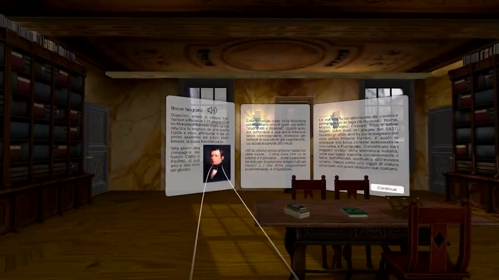
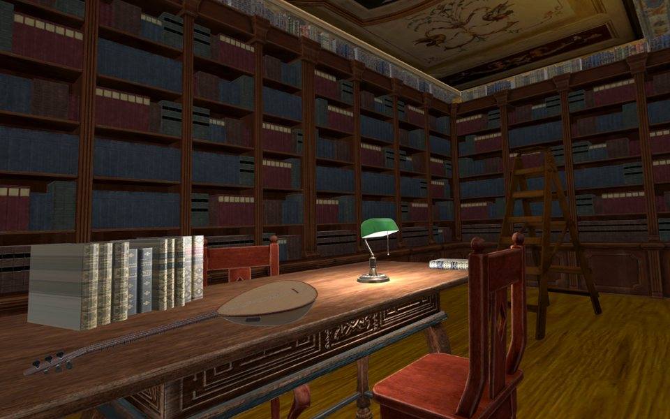
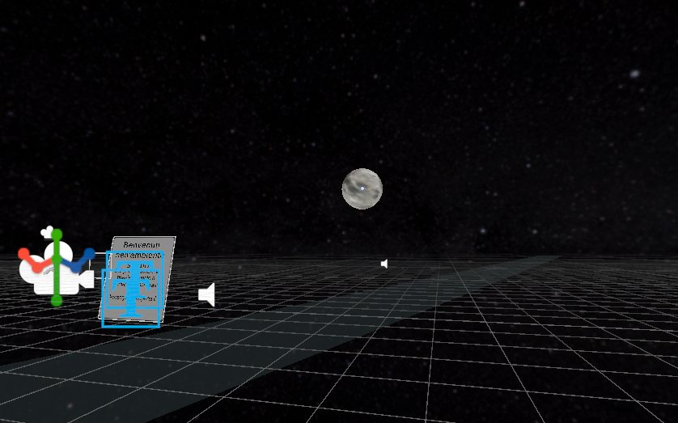
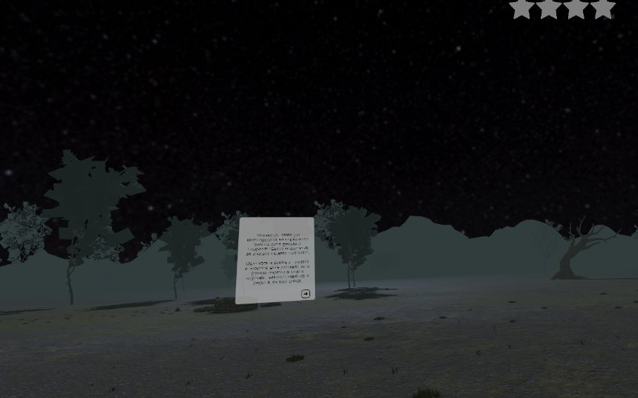
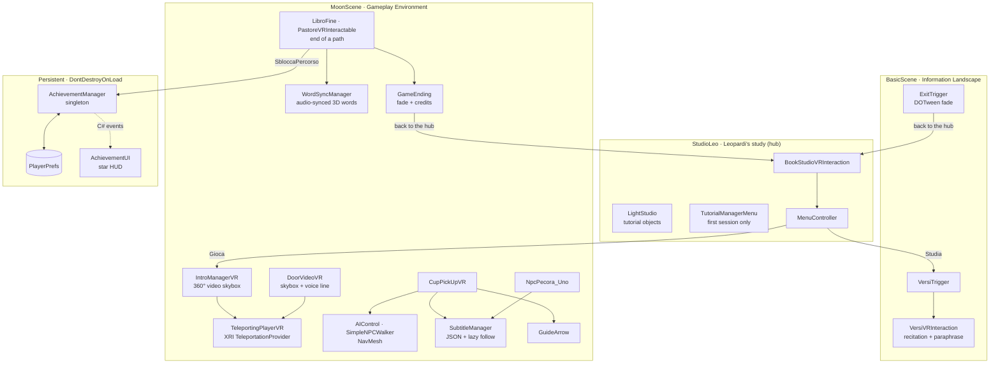

# LeopardiVR

A VR experience for Meta Quest 2 that lets people explore a poem in space.
Designed and built solo in Unity and C# for my Master's thesis in Digital Humanities (University of Pisa, 2026), and evaluated with 40 participants.

🌐 **[Case study on my portfolio](LINK)**

<!-- To show the video here: edit this file on GitHub and drag leopardivr-loop.mp4 onto this line. -->

---

## About the project

LeopardiVR is based on Giacomo Leopardi's *Canto notturno di un pastore errante dell'Asia* and on the poet's handwritten manuscript, held at the National Library of Naples. Users move through three connected spaces:

- **Leopardi's study in Recanati** (`StudioLeo`): onboarding, interaction tutorial and main menu.
- **The Information Landscape** (`BasicScene`): the poem laid out stanza by stanza along a walkway, with recited audio and a paraphrase for each stanza.
- **The Gameplay Environment** (`MoonScene`): interacting with objects and characters unlocks four reading paths, based on the different stanza orders found in the manuscript.

| Leopardi's study | Information Landscape | Gameplay Environment |
|---|---|---|
|  |  |  |

## Architecture

## Technical highlights

- **Custom XR interactables.** Most interactive objects extend the XR Interaction Toolkit's `XRSimpleInteractable` or `XRGrabInteractable`, overriding hover and select to add outline feedback and one-time behaviors. Before disabling a grabbed object, `CupPickUpVR` releases it from the user's hand with `interactionManager.SelectExit()`, so the controller is never left holding a disabled object.
- **Event-driven progress tracking.** `AchievementManager` is a singleton that survives scene loads and exposes C# events. `AchievementUI` subscribes to them instead of checking progress every frame, and unsubscribes when its scene is unloaded. Progress is saved with `PlayerPrefs`.
- **Audio and text synchronization.** `SubtitleManager` reads subtitle timings from JSON files and shows them on a panel that smoothly follows the user's gaze. `WordSyncManager` fades 3D words in and out following the recitation, through two properties of a custom shader.
- **Story-driven teleportation.** `TeleportingPlayerVR` sends teleport requests to the XR Interaction Toolkit's `TeleportationProvider`, so the story can move the user at key moments, such as after the intro video and through the labyrinth door.
- **360° video and skybox changes.** `IntroManagerVR` and `DoorVideoVR` swap the skybox, hide and restore parts of the world, and update the ambient lighting with `DynamicGI.UpdateEnvironment()`.
- **A living flock.** `AIControl` moves each sheep with the NavMesh through a walk, eat and idle loop, with random speed, walk-cycle offset and bleat pitch, so the flock never moves in sync.
- **Performance on standalone VR.** Baked lighting and fog keep the frame rate stable on Meta Quest 2.

## Scripts

| Folder | Script | What it does |
|---|---|---|
| Core | `AchievementManager` | Tracks the four reading paths, raises events on completion, saves progress, runs "after this voice line" sequences |
| Core | `GameEnding` | Closing sequence: fade to black, credits, back to the study |
| Study | `BookStudioVRInteraction` | The book on the desk: opens the main menu |
| Study | `MenuController` | Main menu: Study / Play, continue or new game, quit |
| Study | `TutorialManagerMenu` | Shows the tutorial panels only the first time |
| Study | `LightStudio` | Desk lamp, one of the tutorial objects |
| InformationLandscape | `VersiTrigger` | Shows a stanza when the user walks into its area |
| InformationLandscape | `VersiVRInteraction` | Selecting a stanza plays its recitation and shows its paraphrase |
| InformationLandscape | `ExitTrigger` | End of the walkway: fades out and returns to the study |
| Gameplay | `IntroManagerVR` | Opening 360° video as skybox, then teleport to the start |
| Gameplay | `TeleportingPlayerVR` | Moves the player through the XRI teleportation system |
| Gameplay | `CupPickUpVR` | Grabbable cup: starts a voice line, the flock and the shepherd |
| Gameplay | `DoorVideoVR` | Labyrinth door: skybox change, voice line, teleport |
| Gameplay | `LibroFine` | Book that closes a reading path |
| Audio | `WordSyncManager` | 3D words in sync with the recited audio |
| UI | `SubtitleManager` | Subtitles in sync with voice lines, panel that follows the user |
| UI | `SubtitleTrigger` | Subtitle file + audio for one voice line |
| UI | `AchievementUI` | Star HUD and "path unlocked" notification |
| UI | `GuideArrow` | Arrow that points to the next interaction |
| NPC | `AIControl` | Grazing behavior for the sheep |
| NPC | `SimpleNPCWalker` | Moves the shepherd to a target point |
| NPC | `NpcPecora_Uno` | The goat: reacts differently on each playthrough |
| NPC | `PastoreVRInteractable` | Seated shepherd that closes a reading path |

Small scene scripts (doors that open once, trigger lights in the labyrinth) and the variants of the end-of-path scripts for the other reading paths are not included: they follow the same pattern as the ones above.

### A note on names

The scripts are the ones running in the project, so some class, method and field names are in Italian. Comments are in English. A short glossary:

| Italian | English |
|---|---|
| `percorso`, `idPercorso` | reading path, path index |
| `SbloccaPercorso` | unlock path |
| `ChiamaNascondiHUD` | request hiding the HUD |
| `IniziaSequenza` | start sequence |
| `strofa`, `versi`, `parole` | stanza, verses, words |
| `parafrasi` | paraphrase |
| `pastore`, `pecora`, `capra` | shepherd, sheep, goat |
| `libro`, `luce`, `porta` | book, light, door |
| `pannello`, `freccia` | panel, arrow |

## User study

40 participants, counterbalanced design, sessions observed live through headset casting, followed by a 26-item questionnaire.

- 4.3/5 immersion & presence
- 4.3/5 usability
- 97.5% said the experience was useful for studying the poem

## What I would do differently

Each of the four reading paths reuses the same stanzas in a different order. I built them by duplicating the stanza objects and adapting the script for each case (a stanza that ends the path or one that continues it). It works, but it repeats content and logic. Next time I would describe each stanza once as a ScriptableObject and define each path as an ordered list of those assets, so one generic script could handle every path.

## Notes

- **Kiosk mode for user testing.** `MenuController` clears all saved progress when the app starts and when it is closed, so every participant starts from the beginning.
- **Dependencies:** Unity 6 (URP), XR Interaction Toolkit, TextMeshPro, DOTween, and Quick Outline (Asset Store) for the highlight on interactive objects.
- This repository contains the C# scripts I wrote for the project. The full Unity project is not included because it uses third-party assets (3D models from Sketchfab, characters from Adobe Fuse and Mixamo, and a historical audio recording) that cannot be redistributed.

## Author

**Rachele Sabbatini**: XR Designer
[Portfolio](LINK) · [LinkedIn](https://www.linkedin.com/in/rachele-sabbatini-669364280/) · rachele.sabbatini03@gmail.com
